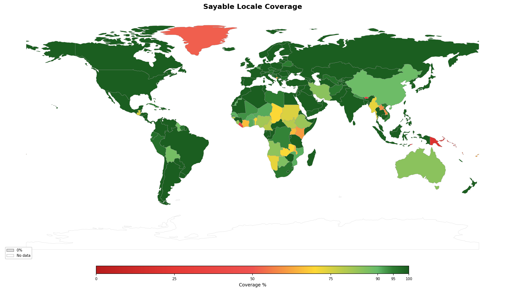

<!-- Generated by tools/geography/generate.py — do not edit by hand -->

# Locale Coverage

How well do Sayable's locales cover the world's languages?

## Global Summary

| Metric | Count |
|--------|------:|
| Countries tracked | 178 |
| 100% coverage | 108 |
| 76–100% (high) | 156 |
| 51–75% (good) | 172 |
| 1–50% (some) | 6 |
| 0% (none) | 0 |

## By Continent

| Continent | Countries | Avg Coverage | Details |
|-----------|----------:|-------------:|--------:|
| Africa | 52 | 89% | [Africa](africa.md) |
| Asia | 49 | 94% | [Asia](asia.md) |
| Europe | 39 | 98% | [Europe](europe.md) |
| North America | 19 | 95% | [North America](north-america.md) |
| Oceania | 7 | 62% | [Oceania](oceania.md) |
| South America | 12 | 97% | [South America](south-america.md) |

## Supported Locales (145)

| Code | Name | Components |
|------|------|------------|
| `af` | Afrikaans | age, date, duration, time |
| `ak` | Akan | age, date, duration, time |
| `am` | Amharic | age, date, duration, time |
| `ar` | Arabic | age, date, duration, time |
| `az` | Azerbaijani | age, date, duration, time |
| `bci` | Baoulé | age, date, duration, time |
| `be` | Belarusian | age, date, duration, time |
| `bem` | Bemba | age, date, duration, time |
| `bg` | Bulgarian | age, date, duration, time |
| `bm` | Bambara | age, date, duration, time |
| `bn` | Bengali | age, date, duration, time |
| `br` | Breton | age, date, duration, time |
| `bs` | Bosnian | age, date, duration, time |
| `ca` | Catalan | age, date, duration, time |
| `ceb` | Cebuano | age, date, duration, time |
| `cs` | Czech | age, date, duration, time |
| `cy` | Welsh | age, date, duration, time |
| `da` | Danish | age, date, duration, time |
| `de` | German | age, date, duration, time |
| `din` | Dinka | age, date, duration, time |
| `dje` | Zarma | age, date, duration, time |
| `dyu` | Dyula | age, date, duration, time |
| `ee` | Ewe | age, date, duration, time |
| `el` | Greek | age, date, duration, time |
| `en` | English | age, date, duration, time |
| `es` | Spanish | age, date, duration, time |
| `et` | Estonian | age, date, duration, time |
| `eu` | Basque | age, date, duration, time |
| `fa` | Persian | age, date, duration, time |
| `fan` | Fang | age, date, duration, time |
| `ff` | Fulah | age, date, duration, time |
| `fi` | Finnish | age, date, duration, time |
| `fil` | Filipino | age, date, duration, time |
| `fon` | Fon | age, date, duration, time |
| `fr` | French | age, date, duration, time |
| `ga` | Irish | age, date, duration, time |
| `gd` | Scottish Gaelic | age, date, duration, time |
| `gl` | Galician | age, date, duration, time |
| `gn` | Guarani | age, date, duration, time |
| `gu` | Gujarati | age, date, duration, time |
| `gv` | Manx | age, date, duration, time |
| `ha` | Hausa | age, date, duration, time |
| `he` | Hebrew | age, date, duration, time |
| `hi` | Hindi | age, date, duration, time |
| `hr` | Croatian | age, date, duration, time |
| `ht` | Haitian Creole | age, date, duration, time |
| `hu` | Hungarian | age, date, duration, time |
| `hy` | Armenian | age, date, duration, time |
| `id` | Indonesian | age, date, duration, time |
| `ig` | Igbo | age, date, duration, time |
| `is` | Icelandic | age, date, duration, time |
| `it` | Italian | age, date, duration, time |
| `ja` | Japanese | age, date, duration, time |
| `jv` | Javanese | age, date, duration, time |
| `ka` | Georgian | age, date, duration, time |
| `kbp` | Kabiye | age, date, duration, time |
| `kk` | Kazakh | age, date, duration, time |
| `km` | Khmer | age, date, duration, time |
| `kn` | Kannada | age, date, duration, time |
| `ko` | Korean | age, date, duration, time |
| `kpe` | Kpelle | age, date, duration, time |
| `ktu` | Kituba | age, date, duration, time |
| `ku` | Kurdish | age, date, duration, time |
| `kw` | Cornish | age, date, duration, time |
| `ky` | Kyrgyz | age, date, duration, time |
| `lg` | Luganda | age, date, duration, time |
| `ln` | Lingala | age, date, duration, time |
| `lo` | Lao | age, date, duration, time |
| `lt` | Lithuanian | age, date, duration, time |
| `lv` | Latvian | age, date, duration, time |
| `men` | Mende | age, date, duration, time |
| `mfe` | Mauritian Creole | age, date, duration, time |
| `mg` | Malagasy | age, date, duration, time |
| `mi` | Māori | age, date, duration, time |
| `mk` | Macedonian | age, date, duration, time |
| `ml` | Malayalam | age, date, duration, time |
| `mn` | Mongolian | age, date, duration, time |
| `mnk` | Mandinka | age, date, duration, time |
| `mos` | Moore | age, date, duration, time |
| `mr` | Marathi | age, date, duration, time |
| `ms` | Malay | age, date, duration, time |
| `mt` | Maltese | age, date, duration, time |
| `my` | Burmese | age, date, duration, time |
| `nb` | Norwegian Bokmål | age, date, duration, time |
| `nd` | Northern Ndebele | age, date, duration, time |
| `ne` | Nepali | age, date, duration, time |
| `ng` | Oshiwambo | age, date, duration, time |
| `nl` | Dutch | age, date, duration, time |
| `nso` | Northern Sotho | age, date, duration, time |
| `nus` | Nuer | age, date, duration, time |
| `ny` | Chichewa | age, date, duration, time |
| `om` | Oromo | age, date, duration, time |
| `or` | Odia | age, date, duration, time |
| `pa` | Punjabi | age, date, duration, time |
| `pl` | Polish | age, date, duration, time |
| `pov` | Guinea-Bissau Creole | age, date, duration, time |
| `ps` | Pashto | age, date, duration, time |
| `pt` | Portuguese | age, date, duration, time |
| `qu` | Quechua | age, date, duration, time |
| `ro` | Romanian | age, date, duration, time |
| `ru` | Russian | age, date, duration, time |
| `rw` | Kinyarwanda | age, date, duration, time |
| `sar` | Sara | age, date, duration, time |
| `sd` | Sindhi | age, date, duration, time |
| `sg` | Sango | age, date, duration, time |
| `shi` | Tachelhit | age, date, duration, time |
| `si` | Sinhala | age, date, duration, time |
| `sk` | Slovak | age, date, duration, time |
| `sl` | Slovenian | age, date, duration, time |
| `sn` | Shona | age, date, duration, time |
| `snk` | Soninke | age, date, duration, time |
| `so` | Somali | age, date, duration, time |
| `sq` | Albanian | age, date, duration, time |
| `sr` | Serbian | age, date, duration, time |
| `ss` | siSwati | age, date, duration, time |
| `st` | Southern Sotho | age, date, duration, time |
| `su` | Sundanese | age, date, duration, time |
| `suk` | Sukuma | age, date, duration, time |
| `sv` | Swedish | age, date, duration, time |
| `sw` | Swahili | age, date, duration, time |
| `ta` | Tamil | age, date, duration, time |
| `te` | Telugu | age, date, duration, time |
| `tem` | Temne | age, date, duration, time |
| `tg` | Tajik | age, date, duration, time |
| `th` | Thai | age, date, duration, time |
| `ti` | Tigrinya | age, date, duration, time |
| `tig` | Tigre | age, date, duration, time |
| `tk` | Turkmen | age, date, duration, time |
| `tn` | Tswana | age, date, duration, time |
| `tr` | Turkish | age, date, duration, time |
| `ts` | Tsonga | age, date, duration, time |
| `tzm` | Central Atlas Tamazight | age, date, duration, time |
| `uk` | Ukrainian | age, date, duration, time |
| `umb` | Umbundu | age, date, duration, time |
| `ur` | Urdu | age, date, duration, time |
| `uz` | Uzbek | age, date, duration, time |
| `vi` | Vietnamese | age, date, duration, time |
| `vmw` | Makhuwa | age, date, duration, time |
| `wo` | Wolof | age, date, duration, time |
| `xh` | Xhosa | age, date, duration, time |
| `yo` | Yoruba | age, date, duration, time |
| `yue` | Cantonese | age, date, duration, time |
| `zdj` | Comorian | age, date, duration, time |
| `zh` | Chinese | age, date, duration, time |
| `zu` | Zulu | age, date, duration, time |

---

*Generated by `tools/geography/generate.py` from data in `tools/geography/countries.json`.*
