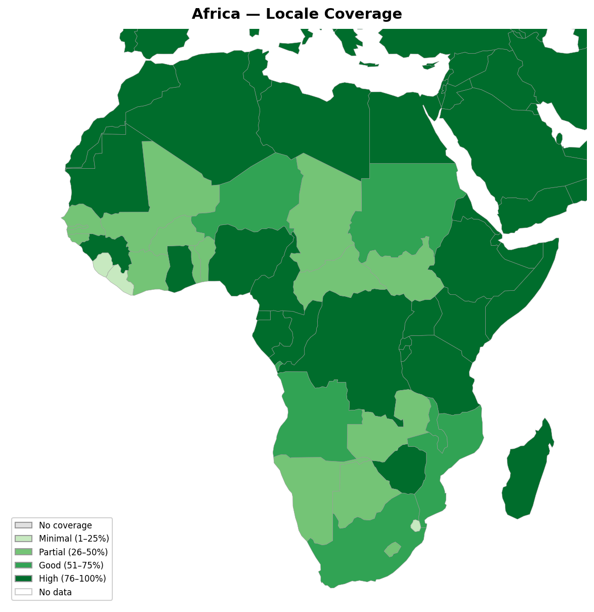

<!-- Generated by tools/geography/generate.py — do not edit by hand -->

# Africa

[Back to Locale Coverage](README.md)

## Summary

- **Countries**: 52
- **Average coverage**: 69%

## Countries

| Country | Coverage | Covered Languages | Uncovered Languages |
|---------|:--------:|-------------------|---------------------|
| Algeria | 100% | Arabic (72%), Tamazight (27%), French (33%) | — |
| Angola | 74% | Portuguese (71%), Lingala (3%) | — |
| Benin | 47% | French (35%), Yoruba (12%) | — |
| Botswana | 32% | English (30%), Shona (2%) | — |
| Burkina Faso | 33% | French (25%), Fulfulde (8%) | — |
| Burundi | 100% | Kirundi (97%), French (8%), Swahili (2%), English (3%) | — |
| Cameroon | 86% | French (57%), English (22%), Fulfulde (7%) | — |
| Central African Republic | 28% | French (23%), Lingala (5%) | — |
| Chad | 39% | French (13%), Arabic (26%) | — |
| Comoros | 35% | Arabic (20%), French (15%) | — |
| Congo | 90% | French (60%), Lingala (30%) | — |
| Cote d'Ivoire | 34% | French (34%) | — |
| Democratic Republic of the Congo | 90% | French (51%), Lingala (20%), Swahili (15%), Luganda (4%) | — |
| Djibouti | 100% | French (34%), Arabic (11%), Somali (60%), Afar (34%) | — |
| Egypt | 100% | Arabic (94%), English (14%), French (3%) | — |
| Equatorial Guinea | 100% | Spanish (68%), French (27%), Portuguese (5%) | — |
| Eritrea | 80% | Tigrinya (55%), Arabic (20%), English (5%) | — |
| Eswatini | 20% | English (20%) | — |
| Ethiopia | 83% | Amharic (32%), Oromo (34%), Somali (6%), Tigrinya (6%), English (5%) | — |
| Gabon | 80% | French (80%) | — |
| Gambia | 40% | English (20%), Fulfulde (18%), Yoruba (2%) | — |
| Ghana | 100% | English (58%), Akan (44%), Hausa (5%), Igbo (1%), Yoruba (1%) | — |
| Guinea | 79% | French (25%), Fulfulde (33%), Susu (21%) | — |
| Guinea-Bissau | 30% | Portuguese (14%), Fulfulde (16%) | — |
| Kenya | 100% | Swahili (67%), English (31%), Ganda (1%), Somali (1%) | — |
| Lesotho | 32% | English (30%), Zulu (2%) | — |
| Liberia | 20% | English (20%) | — |
| Libya | 95% | Arabic (95%) | — |
| Madagascar | 100% | Malagasy (95%), French (20%), English (5%) | — |
| Malawi | 72% | Chewa (57%), English (15%) | — |
| Mali | 34% | French (20%), Fulfulde (14%) | — |
| Mauritania | 100% | Arabic (80%), French (15%), Fulfulde (8%) | — |
| Mauritius | 100% | English (50%), French (73%), Hindi (3%) | — |
| Morocco | 100% | Arabic (65%), Tamazight (26%), French (33%) | — |
| Mozambique | 56% | Portuguese (50%), Swahili (6%) | — |
| Namibia | 29% | English (17%), Afrikaans (11%), German (1%) | — |
| Niger | 73% | French (13%), Hausa (53%), Fulfulde (6%), Arabic (1%) | — |
| Nigeria | 100% | English (53%), Hausa (27%), Yoruba (15%), Igbo (12%), Fulfulde (5%) | — |
| Rwanda | 100% | Kinyarwanda (93%), French (8%), English (15%), Swahili (2%) | — |
| Senegal | 49% | French (26%), Fulfulde (23%) | — |
| Sierra Leone | 20% | English (20%) | — |
| Somalia | 100% | Somali (95%), Arabic (20%), English (5%) | — |
| South Africa | 63% | Zulu (23%), Xhosa (16%), Afrikaans (13%), English (10%), Shona (1%) | — |
| South Sudan | 27% | English (10%), Arabic (15%), Swahili (2%) | — |
| Sudan | 75% | Arabic (70%), English (5%) | — |
| Tanzania | 100% | Swahili (90%), English (15%) | — |
| Togo | 37% | French (37%) | — |
| Tunisia | 100% | Arabic (93%), French (52%), English (8%) | — |
| Uganda | 78% | English (30%), Swahili (30%), Luganda (16%), Chewa (2%) | — |
| Western Sahara | 90% | Arabic (90%) | — |
| Zambia | 35% | English (20%), Chewa (15%) | — |
| Zimbabwe | 100% | English (30%), Shona (70%), Ndebele (16%) | — |

---

*Generated by `tools/geography/generate.py`.*
