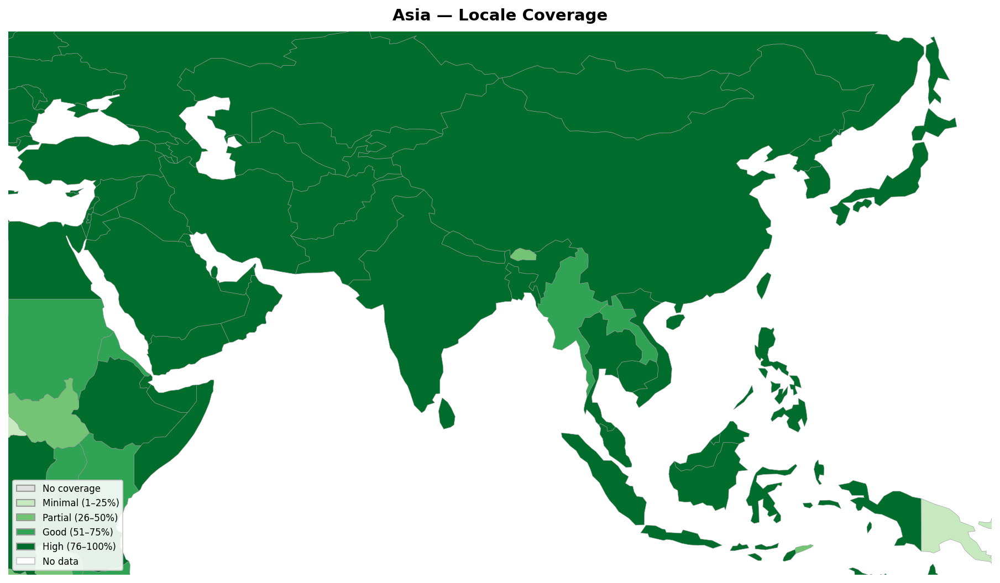

<!-- Generated by tools/geography/generate.py — do not edit by hand -->

# Asia

[Back to Locale Coverage](README.md)

## Summary

- **Countries**: 49
- **Average coverage**: 94%

## Countries

| Country | Coverage | Covered Languages | Uncovered Languages |
|---------|:--------:|-------------------|---------------------|
| Afghanistan | 96% | Dari (Persian) (50%), Pashto (35%), Uzbek (9%), Turkmen (2%) | — |
| Armenia | 100% | Armenian (98%), Russian (15%) | — |
| Azerbaijan | 100% | Azerbaijani (93%), Russian (15%) | — |
| Bahrain | 100% | Arabic (70%), English (30%), Persian (10%), Urdu (8%) | — |
| Bangladesh | 100% | Bengali (98%), English (10%) | — |
| Bhutan | 32% | Nepali (22%), English (10%) | Dzongkha (25%), Tshangla (22%) |
| Brunei | 100% | Malay (83%), English (30%), Chinese (10%) | — |
| Cambodia | 100% | Khmer (96%), English (5%), French (2%) | — |
| China | 89% | Chinese (Mandarin) (73%), Cantonese (6%), English (10%) | — |
| Cyprus | 100% | Greek (72%), Turkish (18%), English (40%) | — |
| Georgia | 100% | Georgian (87%), Russian (15%), Azerbaijani (6%), Armenian (6%) | — |
| India | 100% | Hindi (44%), Bengali (8%), Telugu (7%), Marathi (7%), Tamil (6%), Gujarati (5%), Kannada (4%), Malayalam (3%), Odia (3%), Punjabi (3%), Urdu (5%), English (10%), Sindhi (1%), Nepali (1%) | — |
| Indonesia | 100% | Indonesian (94%), Javanese (31%), Sundanese (15%), Malay (7%), English (10%) | — |
| Iran | 85% | Persian (53%), Azerbaijani (18%), Kurdish (10%), Arabic (2%), Turkmen (2%) | — |
| Iraq | 100% | Arabic (77%), Kurdish (15%), Turkmen (3%), English (7%) | — |
| Israel | 100% | Hebrew (87%), Arabic (20%), Russian (15%), English (60%), French (6%), Amharic (2%) | — |
| Japan | 100% | Japanese (99%), English (15%) | — |
| Jordan | 100% | Arabic (97%), English (15%) | — |
| Kazakhstan | 100% | Kazakh (74%), Russian (84%), English (15%) | — |
| Kuwait | 100% | Arabic (78%), English (40%) | — |
| Kyrgyzstan | 100% | Kyrgyz (72%), Russian (49%), Uzbek (14%) | — |
| Laos | 59% | Lao (53%), French (3%), English (3%) | Khmu (11%), Hmong (9%) |
| Lebanon | 100% | Arabic (93%), French (40%), English (30%), Armenian (4%) | — |
| Malaysia | 100% | Malay (69%), English (50%), Chinese (23%), Tamil (7%) | — |
| Maldives | 20% | English (25%) | Dhivehi (Maldivian) (99%) |
| Mongolia | 100% | Mongolian (95%), Russian (5%), English (10%) | — |
| Myanmar | 73% | Burmese (68%), English (5%) | Shan (9%), Karen languages (7%) |
| Nepal | 93% | Nepali (77%), Hindi (8%), English (8%) | — |
| North Korea | 99% | Korean (99%) | — |
| Oman | 100% | Arabic (74%), English (25%), Urdu (7%), Hindi (5%) | — |
| Pakistan | 100% | Urdu (75%), Punjabi (39%), Pashto (15%), Sindhi (12%), English (10%) | — |
| Palestine | 100% | Arabic (97%), Hebrew (10%), English (8%) | — |
| Philippines | 100% | Filipino (45%), English (55%), Cebuano (16%) | — |
| Qatar | 100% | Arabic (40%), English (60%), Urdu (8%), Hindi (10%), Malayalam (5%), Filipino (5%) | — |
| Saudi Arabia | 100% | Arabic (90%), English (30%), Urdu (7%), Hindi (4%), Filipino (3%) | — |
| Singapore | 100% | English (80%), Chinese (65%), Malay (13%), Tamil (3%) | — |
| South Korea | 100% | Korean (99%), English (30%) | — |
| Sri Lanka | 100% | Sinhala (74%), Tamil (18%), English (10%) | — |
| Syria | 100% | Arabic (90%), Kurdish (9%), French (5%), English (5%) | — |
| Taiwan | 100% | Chinese (Mandarin) (83%), English (28%), Japanese (6%) | — |
| Tajikistan | 100% | Tajik (80%), Russian (28%), Uzbek (17%) | — |
| Thailand | 100% | Thai (92%), Malay (3%), English (15%), Chinese (11%) | — |
| Timor-Leste | 49% | Portuguese (36%), Indonesian (36%), English (16%) | Tetum (91%) |
| Turkey | 100% | Turkish (88%), Kurdish (12%), Arabic (2%), English (17%) | — |
| Turkmenistan | 100% | Turkmen (85%), Russian (12%), Uzbek (5%) | — |
| United Arab Emirates | 100% | Arabic (40%), English (70%), Hindi (15%), Urdu (10%), Malayalam (8%), Filipino (6%), Bengali (4%) | — |
| Uzbekistan | 97% | Uzbek (74%), Russian (15%), Tajik (4%), Kazakh (4%) | — |
| Vietnam | 95% | Vietnamese (85%), English (10%) | — |
| Yemen | 99% | Arabic (99%) | — |

---

*Generated by `tools/geography/generate.py`.*
