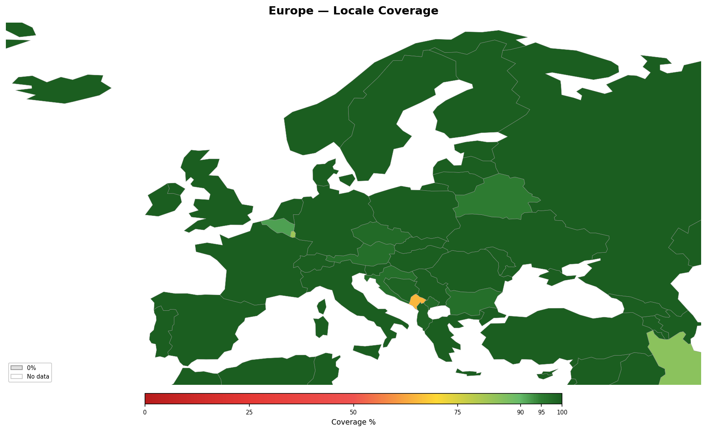

<!-- Generated by tools/geography/generate.py — do not edit by hand -->

# Europe

[Back to Locale Coverage](README.md)

## Summary

- **Countries**: 39
- **Average coverage**: 98%

## Countries

| Country | Coverage | Covered Languages | Uncovered Languages |
|---------|:--------:|-------------------|---------------------|
| Albania | 99% | Albanian (98%), Greek (1%) | — |
| Austria | 97% | German (89%), Turkish (3%), Croatian (2%), Serbian (2%), Hungarian (1%) | — |
| Belarus | 95% | Belarusian (23%), Russian (72%) | — |
| Belgium | 92% | Dutch (55%), French (36%), German (1%) | — |
| Bosnia and Herzegovina | 99% | Bosnian (53%), Serbian (31%), Croatian (15%) | — |
| Bulgaria | 97% | Bulgarian (85%), Turkish (9%), Romanian (3%) | — |
| Croatia | 97% | Croatian (96%), Serbian (1%) | — |
| Czechia | 98% | Czech (96%), Slovak (2%) | — |
| Denmark | 100% | Danish (93%), English (86%), German (47%) | — |
| Estonia | 100% | Estonian (69%), Russian (29%), English (46%) | — |
| Finland | 100% | Finnish (87%), Swedish (5%), English (70%) | — |
| France | 100% | French (93%), Arabic (4%), English (39%), Spanish (6%), Portuguese (3%), German (6%), Italian (2%), Breton (1%), Basque (1%) | — |
| Germany | 100% | German (90%), English (56%), Turkish (4%), Russian (3%), Arabic (2%), Polish (2%) | — |
| Greece | 100% | Greek (95%), English (51%) | — |
| Hungary | 100% | Hungarian (98%), English (20%), German (11%) | — |
| Iceland | 100% | Icelandic (94%), English (88%), Danish (30%) | — |
| Ireland | 100% | English (94%), Irish (40%) | — |
| Italy | 100% | Italian (93%), English (34%), French (16%), German (2%), Spanish (7%) | — |
| Kosovo | 98% | Albanian (92%), Serbian (5%), Turkish (1%) | — |
| Latvia | 100% | Latvian (62%), Russian (34%), English (46%) | — |
| Lithuania | 100% | Lithuanian (85%), Russian (19%), Polish (6%), English (38%) | — |
| Luxembourg | 100% | French (96%), German (71%), English (56%), Portuguese (13%) | Luxembourgish (49%) |
| Malta | 100% | Maltese (90%), English (89%), Italian (66%) | — |
| Moldova | 100% | Romanian (76%), Russian (27%), Ukrainian (6%) | — |
| Montenegro | 65% | Serbian (43%), Bosnian (15%), Albanian (5%), Croatian (2%) | Montenegrin (35%) |
| Netherlands | 100% | Dutch (96%), English (90%), German (71%), French (29%) | — |
| Norway | 100% | Norwegian Bokmal (90%), English (90%) | — |
| Poland | 100% | Polish (97%), English (34%), German (15%), Russian (4%) | — |
| Portugal | 100% | Portuguese (96%), English (27%), French (15%), Spanish (10%) | — |
| Romania | 100% | Romanian (91%), Hungarian (6%), English (31%) | — |
| Russia | 100% | Russian (97%), English (11%) | — |
| Serbia | 100% | Serbian (88%), Hungarian (4%), Bosnian (2%), Albanian (1%), Croatian (1%), English (18%) | — |
| Slovakia | 100% | Slovak (81%), Hungarian (10%), Czech (1%), English (26%) | — |
| Slovenia | 100% | Slovenian (87%), Serbian (6%), Croatian (6%), English (59%), German (42%) | — |
| Spain | 100% | Spanish (92%), Catalan (17%), Galician (5%), Basque (2%), English (27%) | — |
| Sweden | 100% | Swedish (87%), English (86%), Finnish (5%), Arabic (5%) | — |
| Switzerland | 100% | German (63%), French (23%), Italian (8%), English (45%) | — |
| Ukraine | 100% | Ukrainian (68%), Russian (30%), English (18%) | — |
| United Kingdom | 100% | English (92%), Welsh (1%), Scottish Gaelic (0%), Polish (2%), Urdu (1%), Punjabi (1%), Bengali (1%), Arabic (1%), French (15%) | — |

---

*Generated by `tools/geography/generate.py`.*
