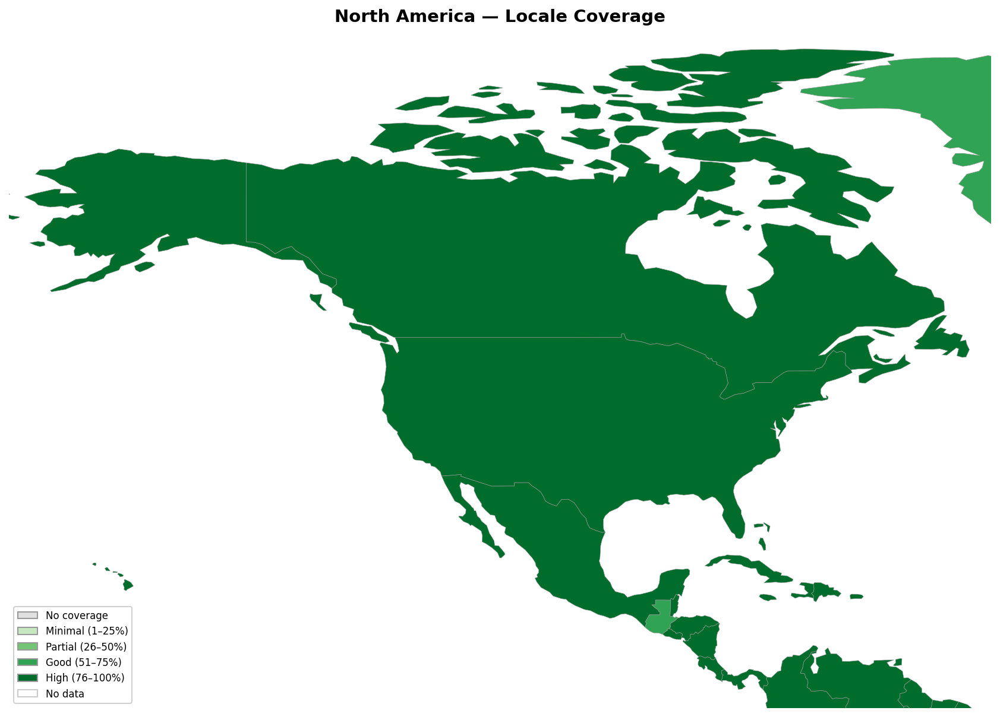

<!-- Generated by tools/geography/generate.py — do not edit by hand -->

# North America

[Back to Locale Coverage](README.md)

## Summary

- **Countries**: 19
- **Average coverage**: 95%

## Countries

| Country | Coverage | Covered Languages | Uncovered Languages |
|---------|:--------:|-------------------|---------------------|
| Bahamas | 100% | English (95%), Haitian Creole (5%) | — |
| Barbados | 95% | English (95%) | — |
| Belize | 100% | English (63%), Spanish (57%) | — |
| Canada | 100% | English (75%), French (23%), Chinese (4%), Punjabi (2%), Spanish (2%), Arabic (1%), Tagalog (2%) | — |
| Costa Rica | 100% | Spanish (97%), English (10%) | — |
| Cuba | 95% | Spanish (95%) | — |
| Dominican Republic | 100% | Spanish (95%), English (8%) | — |
| El Salvador | 99% | Spanish (99%) | — |
| Greenland | 52% | Danish (66%), English (25%) | Kalaallisut (Greenlandic) (85%) |
| Guatemala | 75% | Spanish (93%) | K'iche' (9%), Kaqchikel (8%), Mam (8%), Q'eqchi' (6%) |
| Haiti | 100% | Haitian Creole (96%), French (10%) | — |
| Honduras | 100% | Spanish (98%), English (4%) | — |
| Jamaica | 95% | English (95%) | — |
| Mexico | 100% | Spanish (93%), English (12%) | — |
| Nicaragua | 100% | Spanish (97%), English (6%) | — |
| Panama | 100% | Spanish (93%), English (14%) | — |
| Puerto Rico | 100% | Spanish (94%), English (49%) | — |
| Trinidad and Tobago | 100% | English (95%), Hindi (2%), Spanish (4%) | — |
| United States | 100% | English (78%), Spanish (13%), Chinese (1%), Filipino (1%), Vietnamese (1%), Arabic (1%), French (1%), Korean (1%), German (1%), Hindi (1%), Portuguese (1%), Japanese (0%), Russian (0%) | — |

---

*Generated by `tools/geography/generate.py`.*
