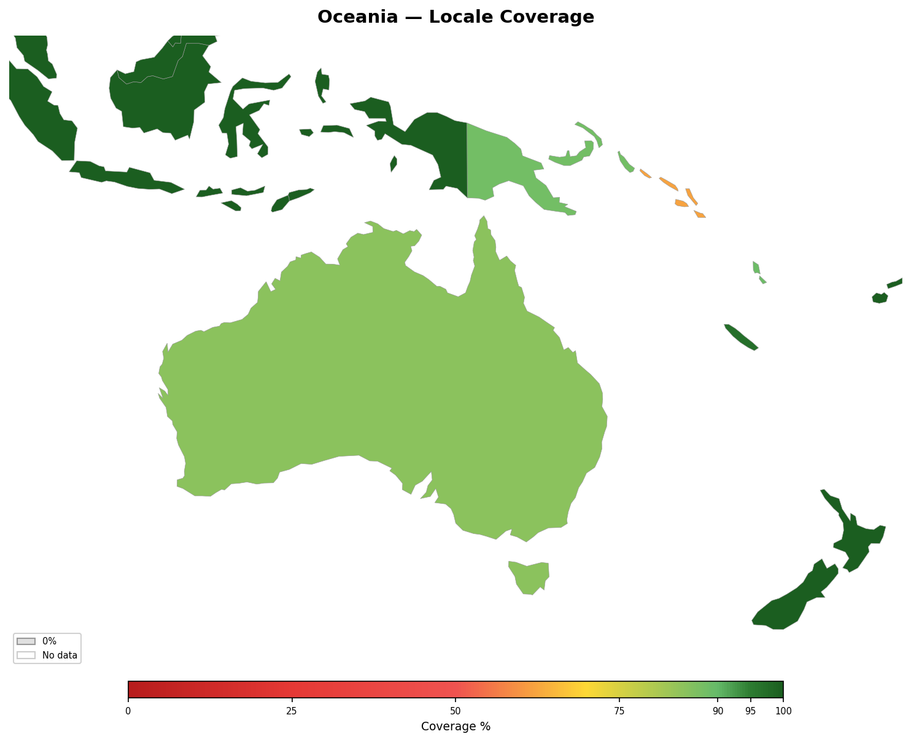

<!-- Generated by tools/geography/generate.py — do not edit by hand -->

# Oceania

[Back to Locale Coverage](README.md)

## Summary

- **Countries**: 7
- **Average coverage**: 89%

## Countries

| Country | Coverage | Covered Languages | Uncovered Languages |
|---------|:--------:|-------------------|---------------------|
| Australia | 85% | English (72%), Chinese (5%), Arabic (2%), Vietnamese (1%), Italian (1%), Greek (1%), Hindi (2%), Punjabi (1%) | — |
| Fiji | 100% | English (55%), Hindi (33%), Fijian (iTaukei) (54%) | — |
| New Caledonia | 97% | French (97%) | — |
| New Zealand | 100% | English (96%), Maori (4%), Chinese (4%), Hindi (3%) | — |
| Papua New Guinea | 88% | English (20%), Tok Pisin (68%) | — |
| Solomon Islands | 62% | English (12%), Pijin (50%) | — |
| Vanuatu | 89% | English (30%), French (25%), Bislama (34%) | — |

## Notes

Oceania's remaining coverage gaps are structural rather than actionable. Papua New Guinea alone has over 800 indigenous languages, most without standardized written forms. Solomon Islands has 70+ local languages, none individually dominant enough to significantly move the coverage number. The lingua francas (English, Tok Pisin, Pijin, Bislama, Fijian) are all covered, meaning the practical communication coverage is higher than the percentage suggests.

Australia's 85% reflects that the country data tracks only the top 8 community languages (all covered). The remaining 15% is spread across dozens of smaller immigrant and indigenous languages, none individually significant enough to be tracked.

---

*Generated by `tools/geography/generate.py`.*
