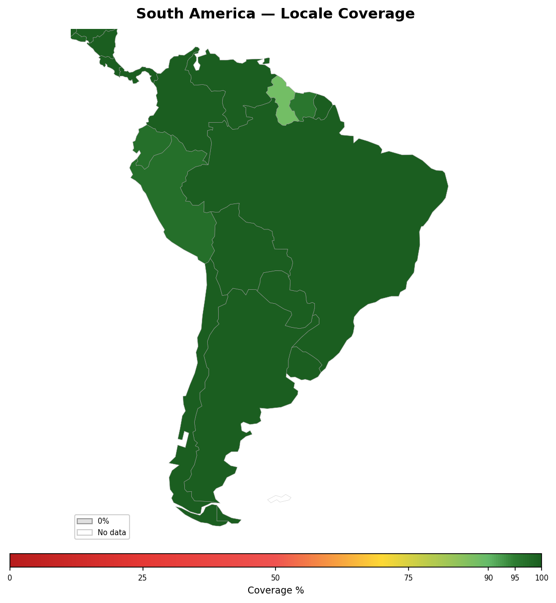

<!-- Generated by tools/geography/generate.py — do not edit by hand -->

# South America

[Back to Locale Coverage](README.md)

## Summary

- **Countries**: 12
- **Average coverage**: 98%

## Countries

| Country | Coverage | Covered Languages | Uncovered Languages |
|---------|:--------:|-------------------|---------------------|
| Argentina | 100% | Spanish (97%), English (7%), Guarani (1%) | — |
| Bolivia | 100% | Spanish (84%), Quechua (21%) | Aymara (15%) |
| Brazil | 100% | Portuguese (98%), English (5%), Spanish (4%), German (1%), Italian (1%), Japanese (1%) | — |
| Chile | 100% | Spanish (95%), English (10%) | — |
| Colombia | 100% | Spanish (99%), English (4%) | — |
| Ecuador | 97% | Spanish (93%), Quechua (4%) | — |
| Guyana | 88% | English (87%), Hindi (1%) | — |
| Paraguay | 100% | Spanish (87%), Guarani (77%) | — |
| Peru | 97% | Spanish (84%), Quechua (13%) | — |
| Suriname | 96% | Dutch (58%), English (20%), Hindi (10%), Javanese (8%) | — |
| Uruguay | 100% | Spanish (95%), Portuguese (5%), English (10%) | — |
| Venezuela | 100% | Spanish (97%), English (5%) | — |

---

*Generated by `tools/geography/generate.py`.*
